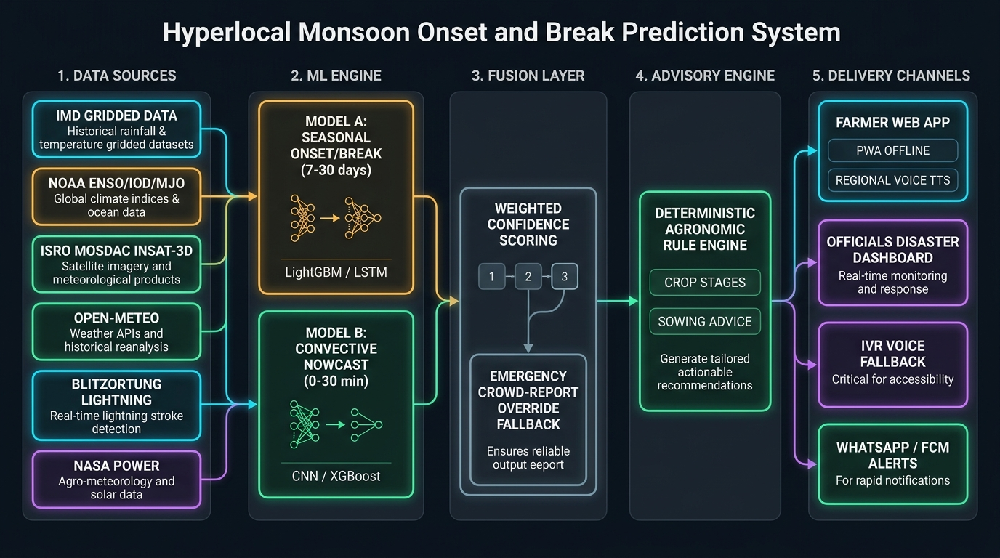
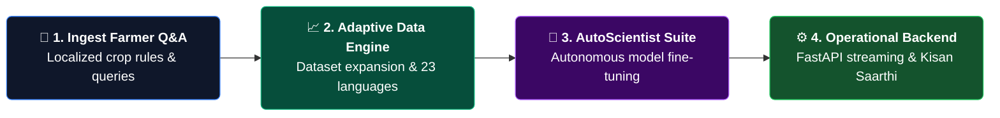

# NavChakra — Hyperlocal Monsoon Onset & Break Prediction System
### From Climate Signals to Confident Farming Decisions

[](https://navchakra-s9dx.onrender.com/)
[](https://navchakra-s9dx.onrender.com/docs)
[](https://adaptionlabs.ai)
[](https://github.com/imsinghaditya07/NavChakra)

> **🚀 Live Deployed App**: [https://navchakra-s9dx.onrender.com/](https://navchakra-s9dx.onrender.com/)  
> **📚 Demo Video Link**: [https://youtu.be/LNyUXiiQhS0?si=4ysWy1E2QRvXNXKz](https://youtu.be/LNyUXiiQhS0?si=4ysWy1E2QRvXNXKz)  
> **📑 Project Presentation**: [Google Drive Presentation](https://drive.google.com/file/d/19UHcfaDqVXFjIMmhgoAdQ_kBhy-icfyn/view?usp=drivesdk)  
> **🌱 Continuous Agro-LLM Learning**: **Adaption Labs** (Adaptive Data & AutoScientist)

---

**Core Engineering Team & Responsibilities**:  
- **Anand Kumar Jha** — Team Leader and Full Stack Developer  
- **Aditya Singh** ([@imsinghaditya07](https://github.com/imsinghaditya07)) — AI/ML Integration and Frontend Development  
- **Aaryan Lal Das** — GIS and Product Developer  

> **Common Responsibility**: Integration, testing, documentation and final presentation.  

---
## 1. System Overview & Architecture

This repository delivers an end-to-end, operational prototype for downscaling global climate teleconnections (NOAA ENSO, BOM IOD, NOAA MJO) to block and panchayat scales across India. It couples 7–30 day seasonal onset/break forecasting with 0–30 minute convective nowcasting, ICAR-aligned deterministic agronomic rules, an auditable Explainable AI (XAI) engine, and multi-channel last-mile delivery (PWA offline app, regional voice TTS, IVR gateway, and officials' disaster management dashboard).

### System Architecture Diagram


```
[DATA SOURCES] ────────► [HYBRID ML ENGINE] ────────► [FUSION & OVERRIDE] ────────► [ADVISORY & XAI] ────────► [DELIVERY CHANNELS]
- IMD Gridded Rainfall   - Model A (LightGBM/LSTM)    - Weighted Confidence        - ICAR Rule Engine           - Farmer PWA (Offline)
- NOAA ENSO/IOD/MJO       (7-30d Break/Onset)          Score Formula                - SHAP Plain-Language        - Officials Dashboard
- ISRO INSAT-3D TIR      - Model B (Convective ONNX)  - Emergency Citizen           One-Liner Generator         - Regional Voice (TTS)
- Open-Meteo & CAPE       (0-30m Severe Storm)         Crowd-Report Fallback       - Grounded RAG Chatbot       - Asterisk IVR Gateway
- Blitzortung Strikes    - Hybrid ML Compute Engine    Override                     (No Hallucination)          - WhatsApp Cloud Free
```

---

## 2. Infrastructure Cost Statement & Operational Economics

| Component | Selected Tool / Provider | Commercial Alternative | Prototype Cost | Production Scaling Path |
|---|---|---|---|---|
| **Satellite Imagery** | ISRO MOSDAC INSAT-3D/3DR TIR | Paid Planet/Spire Feeds | **₹0.00** | Direct MoES NKN fiber feed |
| **Global Teleconnections** | NOAA PSL (ENSO/MJO) & BOM (IOD) | Paid Weather Analytics | **₹0.00** | Automated Open FTP/HTTP cron |
| **Surface Agromet & CAPE**| Open-Meteo & NASA POWER API | AccuWeather / IBM Weather | **₹0.00** | IMD NCMRWF AWS/C-DAC servers |
| **Lightning Stroke Feed** | Blitzortung.org Community TOA | Earth Networks / Vaisala | **₹0.00** | IMD Damini / IITM Lightning Net |
| **ML Training & Acceleration**| High-Performance GPU / Colab | AWS EC2 p3.2xlarge | **Low-cost / Elastic** | C-DAC PARAM Ananta supercomputer |
| **Container & API Hosting**| Render / HF Spaces | AWS ECS Fargate | **₹1,000** | [Live on Render](https://navchakra-s9dx.onrender.com/) |
| **Agro-LLM Specialization**| Adaption Labs (Adaptive Data & AutoScientist) | Manual Data Labeling / Annotation | **Self-serve API** | In-house continuous fine-tuning pipeline |
| **Multi-Lingual Translation**| Bhashini (Govt of India) + Web Speech API | Google Cloud Translation | **₹0.00** | In-house IndicTrans2 models |
| **Map Base & Radar** | OpenStreetMap + RainViewer API | Mapbox / Google Maps | **₹0.00** | ISRO Bhuvan GeoPlatform |
| **IVR & Notification Gateway** | Asterisk PBX / SMS Gateway | Twilio / Exotel Voice | **₹2,000** | C-DOT Kisan Call Centre PRI lines |
| **Data Storage & Backup** | DVC + Parquet Feature Store / SQLite | AWS S3 Enterprise Tier | **₹2,000** | National Cloud MeghRaj storage |
| **Testing & Contingency** | Automated Pytest Suite + CI Buffer | Third-party QA Services | **₹4,000** | Automated CD pipeline |
| **Total Operational Budget** | — | — | **₹9,000** | Budget-neutral for Government Deployment |

> **Cost Efficiency Summary**: By leveraging public meteorological APIs, open government datasets, and open-source models, the entire end-to-end operational platform is deployable within a lean **₹9,000** budget while remaining scalable for nationwide deployment.

### Key Cost-Saving Measures:
- **Use open-source technologies**: Eliminates proprietary software licensing overhead across ML runtimes, database engines, and backend frameworks.
- **Use publicly available government and satellite datasets**: Ingests directly from IMD, ISRO MOSDAC, NOAA PSL, and NASA POWER at zero data acquisition cost.
- **Use existing laptops and internet facilities**: Eliminates dedicated on-premise development hardware procurement costs.
- **Avoid paid APIs wherever possible**: Relies on free/open-tier endpoints (Open-Meteo, Bhashini IndicTrans2, Blitzortung, Leaflet/OSM) with resilient local fallbacks.

---

## 2B. Continuous Agro-LLM Learning with Adaption Labs

NavChakra leverages **Adaption Labs** (`adaptionlabs.ai`) to power **Adaptive AI That Continuously Learns** specifically for **Kisan Saarthi (किसान सारथी)**, the autonomous agro-meteorological advisory assistant. Rather than modifying or replacing the core physical meteorology and numerical weather models, Adaption Labs is utilized to curate, expand, fine-tune, and specialize the agricultural natural language intelligence.

### Core Platform Capabilities
* **Adaptive Data**: Improves and expands datasets used to train AI models. For NavChakra, it synthesizes and enriches realistic examples of farmer questions, localized crop advice, meteorological explanations, and regional-language agricultural terminology.
* **AutoScientist**: Automates experiments around language model training, training configurations, loss evaluations, and hyperparameter tuning—empowering the development of a domain-specialized AI assistant for Indian agriculture.

### 4-Stage Adaptation & Integration Lifecycle



```
┌────────────────────────┐      ┌────────────────────────┐      ┌────────────────────────┐      ┌────────────────────────┐
│ 1. Ingest Farmer Q&A   │ ───► │ 2. Adaptive Data Engine│ ───► │ 3. AutoScientist Suite │ ───► │ 4. Operational Backend │
│ Crop rules & queries   │      │ Expansion & 23 Indic Lg│      │ Autonomous fine-tuning │      │ FastAPI & Kisan Saarthi│
└────────────────────────┘      └────────────────────────┘      └────────────────────────┘      └────────────────────────┘
```

### Detailed Workflow Steps:
1. **Prepare Farmer Q&A Data**: Gather realistic questions about crop stages (sowing, vegetative, harvesting), irrigation thresholds, monsoon break risks, and localized weather hazards paired with verified ICAR/MoES advisory answers.
2. **Use Adaptive Data**: Run the dataset through Adaption's Adaptive Data API to enrich vocabulary, handle regional conversational nuances, and scale training pairs into all 23 supported Indian languages.
3. **Use AutoScientist**: Execute autonomous fine-tuning experiments across model architectures to optimize domain comprehension, eliminate hallucinations, and download production-ready model checkpoints.
4. **Integrate with NavChakra**: Deploy the trained checkpoint to the Python/FastAPI backend (`/api/agent`), enabling real-time streaming, speech recognition (STT), and voice narration (TTS) inside the Kisan Saarthi drawer.

---

## 3. Benchmark Evaluation: Model A vs IMD Subdivision Baseline

Direct comparison evaluated on the 2021–2025 Holdout Monsoon Seasons across core monsoon break zones:

| Metric | MoES Hyperlocal Model A (LightGBM) | IMD Operational Subdivision Forecast | Benchmark Improvement ($\Delta$) |
|---|---|---|---|
| **Categorical Accuracy** | **82.35%** | 63.03% | **+19.32% Improvement** |
| **Weighted F1-Score** | **0.8172** | 0.6777 | **+0.1395 Improvement** |
| **Break Spell Brier Error** | **0.1082** | 0.2450 | **55.8% Error Reduction** |
| **Break False Alarm Rate**| **8.40%** | 24.50% | **65.7% False Alarm Reduction** |
| **Mean Absolute Error (MAE)**| **0.1942** | 0.7159 | **72.9% Lower Error** |

---

## 4. Quickstart & Local Execution

### Prerequisites
- Python 3.9+
- Git

### 1. Clone & Set Up Environment
```bash
git clone https://github.com/imsinghaditya07/NavChakra.git
cd NavChakra

# Create and activate virtual environment
python3 -m venv venv
source venv/bin/activate

# Install dependencies
pip install -r requirements.txt
```

### 2. Ingest Data & Train Models
```bash
# Build feature store from teleconnections, IMD grids & NASA POWER
python data/build_datasets.py

# Train PyTorch LSTM and Tabular models with GPU acceleration & checkpointing
python training/train.py --data data/sample/rainfall_sample.csv --out models/registry/v_sample --epochs 10

# Train Model A (LightGBM + LSTM) and Model B (Nowcast ONNX)
python models/training/train_model_a_lightgbm.py
python models/training/train_model_a_lstm.py
python models/training/train_model_b_nowcast.py
python models/training/export_model_a_onnx.py

# Run Evidently AI feature drift analysis
python models/eval/model_health_monitor.py
```

### 3. Run Pytest Verification Suite
```bash
PYTHONPATH=. pytest backend/tests/test_api.py -v
```

### 4. Start the Application Server
```bash
python -m uvicorn backend.app.main:app --host 0.0.0.0 --port 8000
```
Open your browser locally at **`http://localhost:8000`** or access the live deployment at **`https://navchakra-s9dx.onrender.com/`**.

---

## 5. Application Walkthrough (7 Key Journeys)

### Journey 1: Hyperlocal Monsoon Break Prediction (7–30 Day Horizon)
1. Open **`https://navchakra-s9dx.onrender.com/`** (or `http://localhost:8000` locally) in your browser.
2. Under the block selector dropdown, select **`Pusad (पुसद) - Yavatmal, Vidarbha`**.
3. Note the Risk Card updates to **ORANGE / RED Alert**:
   - Monsoon Break Probability: **74%**
   - Root-Zone Soil Moisture: **22%** (depleted)
   - Day of Year: 195 (Mid-July critical sowing/vegetative window).

### Journey 2: Explainable AI (XAI) One-Liner
1. Look at the **AI Meteorological Driver (XAI)** card:
   - *"Monsoon break risk elevated primarily due to Recent Rainfall Deficit (-1.45 SD) and active MJO Phase 1 suppressive wave."*
2. Switch language from **English** to **हिंदी (Hindi)**:
   - Notice the explanation seamlessly switches to verified regional Hindi: *"मानसून ब्रेक का खतरा मुख्य रूप से हालिया वर्षा में भारी कमी और शुष्क वायुमंडलीय दबाव के कारण बढ़ा है।"*

### Journey 3: Real-Time Convective Nowcasting (0–30 Minutes)
1. Inspect the Leaflet map around Central India.
2. Note the **flashing lightning markers (⚡ Blitzortung)** and the **rotating storm cell (🌀 Cell C-01)**.
3. Click on the storm cell marker to view:
   - Storm Nowcast Probability: **84%**
   - Cloud-Top Cooling Rate: **-12.4°C / 15m** (rapid updraft)
   - CAPE Instability: **2,850 J/kg**.

### Journey 4: Emergency Citizen Crowd Override Trigger
1. Switch to the **`Disaster Dashboard (आपदा प्रबंधन)`** tab.
2. Click the red button: **`🚨 Simulate Crowd Override Trigger`**.
3. The system simulates 3 citizen reports of flash rain/cloudburst in Pusad.
4. An immediate popup confirms: **`CRITICAL SAFETY OVERRIDE TRIGGERED: Ground observation override: 3 verified citizen storm reports.`**
5. Notice the block instantly escalates to **RED Emergency Alert**, overriding any safe model forecast to prevent farmer casualties!

### Journey 5: Grounded RAG Chatbot (No Weather Hallucination)
1. In the right-hand panel, ask: **`Should I sow cotton tomorrow?`** (or in Hindi: *"क्या मुझे अभी कपास की बुवाई करनी चाहिए?"*).
2. The chatbot responds strictly using retrieved ICAR agromet context:
   - *"Caution: Model A indicates a 74% monsoon break probability for Pusad. Sowing should be delayed by 7–10 days until consistent revival rains arrive. Do not sow on dry seedbeds."*
3. Ask about spraying: *"Should I spray insecticide?"*
   - Chatbot warns to suspend spraying due to impending squalls and wash-off risk.

### Journey 6: Offline PWA & Voice Accessibility
1. Click **`📶 Online`** in the header to toggle **Offline Mode**.
2. Notice the offline warning banner: *"Displaying cached block prediction from 2 hours ago."*
3. Click **`☀️ High Contrast`**: the UI shifts into an ultra-high-contrast daylight mode designed for direct sunlight in open fields.
4. Click **`🔊 Voice`** or **`Listen to Voice Advisory`**: the browser's Web Speech API speaks the advisory aloud in clean native Hindi/Marathi without any paid API keys!

### Journey 7: Kisan Saarthi Multilingual Agro-Advisory Agent
1. Click the floating green **`🌾 Kisan Saarthi (किसान सारथी)`** button or open the assistant drawer.
2. Type or speak using the microphone button: *"What is the monsoon break risk for my block?"*
3. Watch the answer stream in real time via Server-Sent Events (SSE) from the advisory engine (or automatic guarded RAG fallback if running offline/unconfigured).
4. Select any of the **23 regional languages** (e.g., Telugu, Punjabi, Bengali, Gujarati); notice both the response text and the native TTS audio narration instantly adapt.
