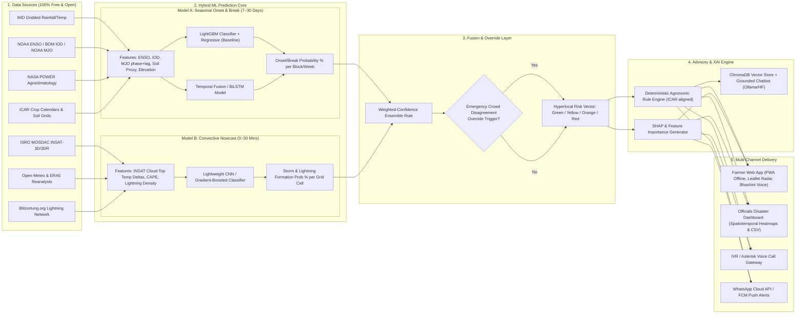

# SIH 2026 Problem Statement 26086
## Hyperlocal Monsoon Onset & Break Prediction System
**Ministry of Earth Sciences (MoES) / NCMRWF**

---

### System Architecture Overview

---

### Detailed Component Specifications

#### 1. Data Ingestion Pipeline (`/data`)
- **IMD Gridded Rainfall**: 0.25° x 0.25° daily rainfall and 1° x 1° temperature grids.
- **Teleconnections / Global Climate Indices**:
  - NOAA Oceanic Niño Index (ONI / ENSO 3.4 SST anomalies).
  - Australian Bureau of Meteorology (BOM) Dipole Mode Index (IOD).
  - NOAA Real-time Multivariate MJO (RMM1, RMM2) tracking 8 phases and amplitudes.
- **Satellite & Remote Sensing**:
  - ISRO MOSDAC INSAT-3D/3DR TIR1/TIR2 cloud-top brightness temperatures.
  - Proxy infrared delta fields $\Delta T_b / \Delta t$ indicating convective updrafts.
- **Agrometeorology & Soil Proxies**:
  - NASA POWER API: Surface solar irradiance (ALLSKY_SFC_SW_DWN), 2m relative humidity, root-zone soil wetness proxy.
  - Open-Meteo: Free API for CAPE (Convective Available Potential Energy), Lifted Index, and wind shear.
- **Real-time Lightning**:
  - Blitzortung.org Community TOA (Time of Arrival) lightning stroke feeds.
- **Admin Boundaries**:
  - Sub-district (Block/Tehsil) boundaries in GeoJSON format (OpenStreetMap / Bhuvan).

---

#### 2. ML Engine (`/models`)

##### Model A: Seasonal Monsoon Onset, Active & Break Cycle (7–30 Days)
- **Objective**: Predict monsoon onset date window, break spells (consecutive days with normalized rainfall $< -1.5\sigma$ over the core monsoon zone), and revival timing.
- **Architecture**:
  - Baseline: LightGBM Multi-output Gradient Boosted Decision Trees with SHAP TreeExplainer.
  - Comparative: Bi-directional LSTM with attention over temporal lag features (1 to 4 weeks).
- **Evaluation vs IMD Baseline**:
  - Benchmarked directly against IMD subdivision extended-range forecasts (ERF).
  - Metrics: Brier Skill Score (BSS), Accuracy, F1-Score, False Alarm Rate (FAR).

##### Model B: Convective Nowcasting (0–30 Minutes)
- **Objective**: Rapid detection and propagation of severe convective storm cells, lightning hazards, and flash squalls.
- **Architecture**:
  - Gradient Boosted Classifier / Conv1D on temporal satellite cloud-top cooling rates, CAPE, CIN, and 15-minute strike density.
  - Inference latency $< 20\text{ ms}$ on CPU using ONNX Runtime.

---

#### 3. Fusion & Safety Override Layer
- **Weighted Confidence Scoring**:
  $$\text{RiskScore}(v) = w_A \cdot P_{\text{break}}(v) + w_B \cdot P_{\text{storm}}(v) + w_{\text{live}} \cdot I_{\text{radar}}(v)$$
- **Emergency Crowd Disagreement Override**:
  - If $\ge 3$ verified ground observations within a 10 km radius report active rainfall/squalls while Model prediction indicates "Safe/Clear", an automated override triggers an immediate advisory escalation to "Emergency Alert" with audit logging.

---

#### 4. Advisory Engine & XAI
- **Deterministic Rule Base (ICAR/Agromet aligned)**:
  - Sowing phase + Break $> 70\%$ $\rightarrow$ Delay sowing by 7–10 days; prepare secondary short-duration crops (e.g., Pearl Millet, Green Gram).
  - Active Tillering + Heavy Rain/Storm $\rightarrow$ Dig field drainage trenches; postpone foliar spray and fertilizer application.
  - Ripening phase + Break $\rightarrow$ Conserve moisture via straw mulching; initiate protective drip irrigation.
- **Explainable AI (XAI)**:
  - SHAP feature attribution translated to plain-language bullet points in regional languages (e.g., *"Break probability elevated by 38% due to active MJO Phase 1 suppressive wave combined with neutral IOD"*).

---

#### 5. Delivery & Last-Mile Access
- **Farmer Web App**: Clean, high-contrast, low-bandwidth PWA with offline caching via Service Worker + IndexedDB.
- **Officials' Disaster Dashboard**: GIS heatmap, block-level filterable table, CSV export, live alerts.
- **Regional Speech/TTS**: Web Speech API + Bhashini endpoint compatibility.
- **IVR / Voice Gateway**: Asterisk AGI script template for feature-phone access via missed-call or dial-in IVR.
